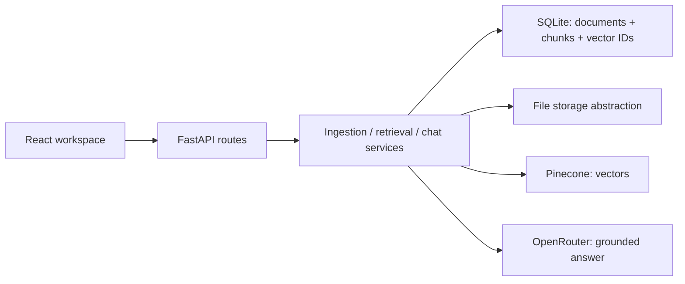

# ClientOps Copilot

**Turn client documents into answers you can verify.** A knowledge workspace for consultants, implementation teams, and customer-success operators, built with React, FastAPI, Pinecone, and OpenRouter.

**[Try the live AI demo](https://clientops-copilot-psi.vercel.app)** · [Architecture](docs/ARCHITECTURE.md) · [Deployment](docs/DEPLOYMENT.md)

Client-facing teams often lose decisions, deadlines, risks, and commitments across briefs, contracts, SOPs, and delivery plans. ClientOps Copilot turns one selected source into a focused working session without hiding retrieval uncertainty behind a success-looking chatbot response.


<p align="center"></p>

## What you can do in two minutes

1. Open the demo and select `client_success_plan.txt`.
2. Ask **“Who owns the mapping review, and when is the pilot launch?”** or run a workflow action: summary, decisions, risks, actions, or dates.
3. Open a citation to inspect the source passage, location, and retrieval score.
4. Switch to `security_review.txt` and ask **“What must happen before production activation, and who owns key rotation?”**

The public demo runs live retrieval and AI generation against two synthetic client documents or your own TXT, PDF, and DOCX uploads. Public uploads are limited to 3 MB and 32,000 extracted characters and remain available only in the current tab until refresh. Extracted text is sent to AI providers; use non-sensitive documents. Sample documents stay read-only. Free service quotas and cold starts can affect availability.

## Product highlights

- focused three-pane workspace with responsive mobile evidence drawer
- mandatory document-scoped Pinecone search and deletion
- relevance-gated question search, document-wide workflow actions, and source-backed follow-ups
- page-aware PDF and paragraph-aware DOCX citations
- SQL-authoritative document/chunk metadata and vector IDs
- rollback and compensating cleanup across database, vector, and file boundaries
- honest duplicate-file detection and actionable lifecycle feedback
- safe public demo mode with bundled non-sensitive documents, locked mutations, and a spend guard
- separate liveness and dependency readiness reporting
- free serverless deployment with hosted embeddings and read-only sample metadata
- 46 credential-free backend tests and 7 frontend tests

## Architecture at a glance



For persisted documents, SQLite owns identity, processing state, chunk text, source locations, checksums, and vector IDs; Pinecone owns vector values. Browser-session uploads carry extracted text and embeddings with each request instead of entering shared SQL or Pinecone storage. OpenRouter receives selected-document evidence with instructions to treat source content as untrusted data.

The Vercel deployment reconstructs disposable SQLite metadata from bundled samples using stable document and vector IDs. Pinecone provides hosted passage/query embeddings and vector search; OpenRouter's free model router generates answers. The local application uses persistent SQLite and source files, with SentenceTransformers embeddings by default.

See [Architecture](docs/ARCHITECTURE.md) for lifecycle diagrams and failure boundaries, [Product audit](docs/PRODUCT_AUDIT.md) for the v1.6 changes, and [Deployment](docs/DEPLOYMENT.md) for hosting details.

## Stack

| Layer | Technology |
|---|---|
| Frontend | React 19, TypeScript, Vite, Tailwind CSS, Lucide |
| API | FastAPI, Pydantic Settings, SQLAlchemy, Alembic |
| Retrieval | Pinecone Inference on Vercel, SentenceTransformers locally, Pinecone vector search |
| Answer generation | OpenRouter via the OpenAI-compatible client |
| Document parsing | PyMuPDF, python-docx |
| Quality | Pytest, Ruff, Vitest, Testing Library, ESLint, Prettier, GitHub Actions |
| Deployment | Vercel Hobby; Docker Compose and Nginx for local use |

## Grounded retrieval contract

1. The API loads the requested document and its authoritative chunks from SQL.
2. The vector-store interface requires `document_id`; Pinecone receives that filter on every query.
3. Returned vector IDs are joined back to SQL chunk text.
4. Matches below `RETRIEVAL_MIN_SCORE` are discarded.
5. With no qualifying evidence, the API returns `insufficient_evidence` and does **not** call the LLM. Document-wide workflow actions select the document's source passages directly, rather than applying a query-similarity threshold to a generic summary prompt.
6. Provider errors return `provider_failure`, distinct from retrieval uncertainty.
7. Supported answers return citations for the exact retrieved passages.

Workflow actions carry explicit intent and use only the selected document. Follow-ups such as “so what should we do?” reuse previously cited source passages and the previous question, rather than treating a generated answer as evidence. Direct source selections are labelled “Document passage” without an invented similarity score. Extraction is not guaranteed to be complete or correct.

## Local setup

Prerequisites: Python 3.11+, Node 22+, a Pinecone index matching the embedding dimension, and Pinecone/OpenRouter credentials. The default `all-MiniLM-L6-v2` model produces 384-dimensional embeddings; use a separate index from the hosted demo.

```bash
cd backend
python3.11 -m venv venv
source venv/bin/activate
pip install -r requirements.txt
cp .env.example .env
# add provider credentials
alembic upgrade head
uvicorn app.main:app --reload
```

In another terminal:

```bash
cd frontend
npm ci
npm run dev
```

Open `http://localhost:5173`. Override the API URL with `VITE_API_BASE_URL` at frontend build time.

### Docker

After creating `backend/.env`:

```bash
docker compose up --build
```

The UI runs at `http://localhost:5173`, the API at `http://localhost:8000`, and named volumes retain SQLite data and source files. This is a local/single-instance demo topology, not horizontal production infrastructure.

## Safe public demo mode

Set `DEMO_MODE=true` on the backend. Demo mode:

- blocks persistent uploads and deletion of shared documents at the API boundary
- optionally allows temporary browser-tab uploads with `ALLOW_SESSION_UPLOADS=true`
- keeps grounded chat on the real retrieval/LLM path
- exposes capabilities to the UI so locked controls are labelled honestly
- applies a per-browser-session soft limit to generated answers; repeated successful sample answers use a bounded cache, and failed retrievals do not consume the allowance
- is designed for the bundled synthetic documents in `backend/demo_documents`

After migrations and provider configuration, seed those documents once:

```bash
cd backend
PYTHONPATH=. python scripts/seed_demo.py
```

The seeder uses the real extraction, embedding, database, and Pinecone ingestion pipeline. A public AI demo requires provider credentials; the Vercel deployment can use free service tiers. See [Deployment](docs/DEPLOYMENT.md).

### Free Vercel recruiter demo

The root `vercel.json` deploys React and FastAPI together. The public demo uses Pinecone hosted embeddings and vector search, and OpenRouter's `openrouter/free` model router for live AI answers. It rebuilds read-only sample metadata in temporary SQLite storage on every new instance, with deterministic vector IDs matching the hosted index. It needs no persistent disk or paid database.

Configure `PINECONE_API_KEY` and `OPENROUTER_API_KEY` as server-only Vercel environment variables, then prepare the bundled evidence:

```bash
cd backend
PYTHONPATH=. python scripts/prepare_vercel_demo.py
cd ..
npx vercel --prod
```

Use Vercel Hobby, Pinecone Starter, and free OpenRouter models. Provider quotas can make the demo temporarily unavailable. Public uploads are parsed in temporary storage, embedded, and returned to the browser; their vectors are searched in memory on later requests. Uploaded content is excluded from the shared answer cache and can be removed from the tab. The session limit is a soft, process-local guard, not a distributed or authenticated quota.

For a persistent container deployment, migration steps, and configuration details, see [Deployment](docs/DEPLOYMENT.md).

## Quality checks

The current release passes **46 backend tests and 7 frontend tests**, plus Ruff, Prettier, ESLint, and the production build. Tests cover document-wide workflows, follow-up isolation, repeated-answer caching, TXT/PDF/DOCX uploads across fresh instances, and safe Markdown rendering.

```bash
cd backend
ruff check .
ruff format --check .
pytest -q

cd ../frontend
npm run format:check
npm run lint
npm test
npm run build
```

The deterministic retrieval evaluation covers expected relevant chunks, threshold-based abstention, document isolation, and a cross-document leakage regression. It intentionally reports behavioral assertions rather than invented accuracy percentages. Tests use fakes and need no live provider credentials.

## API surface

Local routes are shown below. The public deployment adds the `/api` prefix.

| Method | Endpoint | Purpose |
|---|---|---|
| GET | `/health` | process liveness without dependency calls |
| GET | `/ready` | database, storage, Pinecone, LLM, limits, and demo capabilities |
| POST | `/documents/upload` | validate and index a document locally, or create a temporary browser upload publicly |
| GET | `/documents` | list the document library |
| GET | `/documents/{id}` | inspect document metadata/status |
| POST | `/documents/chat` | ask one bounded, document-scoped question |
| DELETE | `/documents/{id}` | clean vectors, source, chunks, and metadata; disabled in demo mode |

## Explicit limitations

ClientOps Copilot is a single-workspace portfolio application. It has no authentication, tenant isolation, durable conversation history, OCR, asynchronous ingestion, formal audit trail, or production observability. Durable local upload workflows use a single persistent instance. The Vercel deployment rebuilds synthetic sample metadata on each instance and keeps uploaded document state only in browser memory.

Retrieval scores and citations help users inspect answers but do not guarantee correctness. Retrieved excerpts go to OpenRouter, and embedding inputs and vector data go to Pinecone. Use synthetic or otherwise approved documents rather than sensitive client data.

See the deliberately scoped [Roadmap](docs/ROADMAP.md). MIT licensed.
