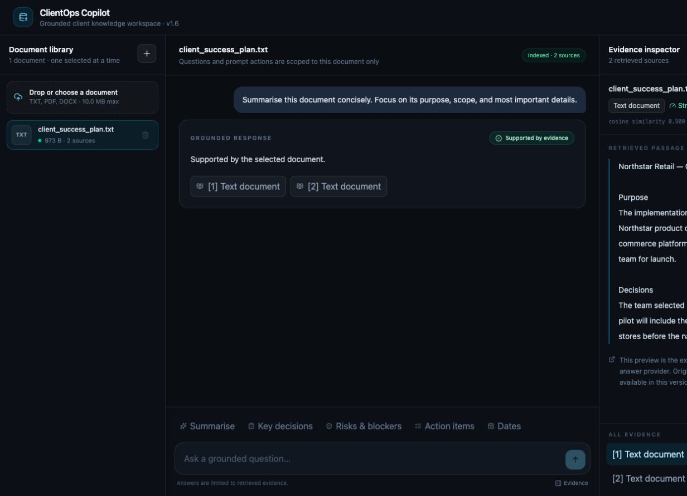
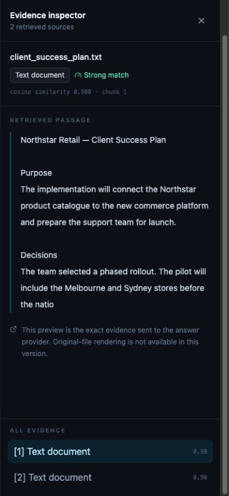
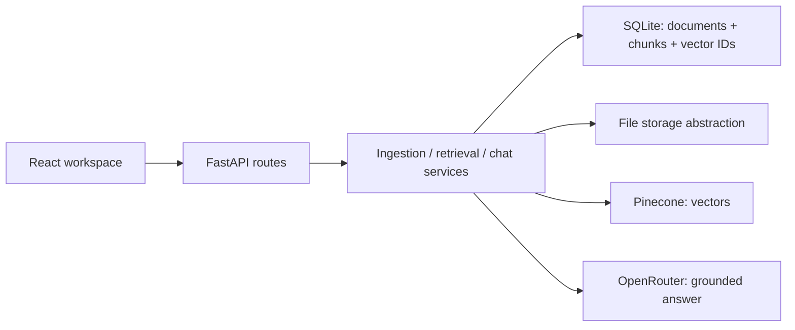

# ClientOps Copilot

**Turn client documents into answers you can verify.** A knowledge workspace for consultants, implementation teams, and customer-success operators, built with React, FastAPI, Pinecone, and OpenRouter.

**[Try the live AI demo](https://clientops-copilot-psi.vercel.app)** · [Architecture](docs/ARCHITECTURE.md) · [Deployment](docs/DEPLOYMENT.md)

Client-facing teams often lose decisions, deadlines, risks, and commitments across briefs, contracts, SOPs, and delivery plans. ClientOps Copilot turns one selected source into a focused working session without hiding retrieval uncertainty behind a success-looking chatbot response.



<p align="center"></p>

## What you can do in two minutes

1. Open the demo and select `client_success_plan.txt`.
2. Ask **“Who owns the mapping review, and when is the pilot launch?”** or run a workflow action: summary, decisions, risks, actions, or dates.
3. Open a citation to inspect the source passage, location, and retrieval score.
4. Switch to `security_review.txt` and ask **“What must happen before production activation, and who owns key rotation?”**

The public demo runs live semantic retrieval and AI generation against two synthetic client documents. Uploads and deletion are disabled publicly; full TXT, PDF, and DOCX ingestion is available locally. Conversations stay in browser memory for the current session. Switching documents keeps retrieval scoped to the selected source. Free service quotas and cold starts can affect availability.

## Product highlights

- focused three-pane workspace with responsive mobile evidence drawer
- mandatory document-scoped Pinecone search and deletion
- relevance threshold before any LLM call
- page-aware PDF and paragraph-aware DOCX citations
- SQL-authoritative document/chunk metadata and vector IDs
- rollback and compensating cleanup across database, vector, and file boundaries
- honest duplicate-file detection and actionable lifecycle feedback
- safe public demo mode with bundled non-sensitive documents, locked mutations, and a spend guard
- separate liveness and dependency readiness reporting
- free serverless deployment with hosted embeddings and read-only sample metadata
- 35 credential-free backend tests and 5 frontend interaction tests

## Architecture at a glance



SQLite owns document identity, processing state, chunk text, source locations, checksums, and vector IDs. Pinecone owns vector values. Source bytes stay behind `LocalFileStorage`. The OpenRouter request receives only threshold-clearing evidence and explicit instructions to treat uploaded content as untrusted data.

The Vercel deployment reconstructs disposable SQLite metadata from bundled samples using stable document and vector IDs. Pinecone provides hosted passage/query embeddings and vector search; OpenRouter's free model router generates answers. The local application uses persistent SQLite and source files, with SentenceTransformers embeddings by default.

See [Architecture](docs/ARCHITECTURE.md) for lifecycle diagrams and failure boundaries, [Product audit](docs/PRODUCT_AUDIT.md) for the v1.6 changes, and [Deployment](docs/DEPLOYMENT.md) for hosting details.

## Stack

| Layer | Technology |
|---|---|
| Frontend | React 19, TypeScript, Vite, Tailwind CSS, Lucide |
| API | FastAPI, Pydantic Settings, SQLAlchemy, Alembic |
| Retrieval | Pinecone Inference on Vercel, SentenceTransformers locally, Pinecone vector search |
| Answer generation | OpenRouter via the OpenAI-compatible client |
| Document parsing | PyMuPDF, python-docx |
| Quality | Pytest, Ruff, Vitest, Testing Library, ESLint, Prettier, GitHub Actions |
| Deployment | Vercel Hobby; Docker Compose and Nginx for local use |

## Grounded retrieval contract

1. The API loads the requested document and its authoritative chunks from SQL.
2. The vector-store interface requires `document_id`; Pinecone receives that filter on every query.
3. Returned vector IDs are joined back to SQL chunk text.
4. Matches below `RETRIEVAL_MIN_SCORE` are discarded.
5. With no qualifying evidence, the API returns `insufficient_evidence` and does **not** call the LLM.
6. Provider errors return `provider_failure`, distinct from retrieval uncertainty.
7. Supported answers return citations for the exact retrieved passages.

The prompt actions are plain question templates routed through this same contract. They do not claim guaranteed structured extraction.

## Local setup

Prerequisites: Python 3.11+, Node 22+, a Pinecone index matching the embedding dimension, and Pinecone/OpenRouter credentials. The default `all-MiniLM-L6-v2` model produces 384-dimensional embeddings; use a separate index from the hosted demo.

```bash
cd backend
python3.11 -m venv venv
source venv/bin/activate
pip install -r requirements.txt
cp .env.example .env
# add provider credentials
alembic upgrade head
uvicorn app.main:app --reload
```

In another terminal:

```bash
cd frontend
npm ci
npm run dev
```

Open `http://localhost:5173`. Override the API URL with `VITE_API_BASE_URL` at frontend build time.

### Docker

After creating `backend/.env`:

```bash
docker compose up --build
```

The UI runs at `http://localhost:5173`, the API at `http://localhost:8000`, and named volumes retain SQLite data and source files. This is a local/single-instance demo topology, not horizontal production infrastructure.

## Safe public demo mode

Set `DEMO_MODE=true` on the backend. Demo mode:

- blocks arbitrary uploads and all document deletion at the API boundary
- keeps grounded chat on the real retrieval/LLM path
- exposes capabilities to the UI so locked controls are labelled honestly
- caps process-local chat requests with `DEMO_CHAT_HOURLY_LIMIT`
- is designed for the bundled synthetic documents in `backend/demo_documents`

After migrations and provider configuration, seed those documents once:

```bash
cd backend
PYTHONPATH=. python scripts/seed_demo.py
```

The seeder uses the real extraction, embedding, database, and Pinecone ingestion pipeline. A public AI demo requires provider credentials; the read-only Vercel deployment can use free service tiers. See [Deployment](docs/DEPLOYMENT.md).

### Free Vercel recruiter demo

The root `vercel.json` deploys React and FastAPI together. The public demo uses Pinecone hosted embeddings and vector search, and OpenRouter's `openrouter/free` model router for live AI answers. It rebuilds read-only sample metadata in temporary SQLite storage on every new instance, with deterministic vector IDs matching the hosted index. It needs no persistent disk or paid database.

Configure `PINECONE_API_KEY` and `OPENROUTER_API_KEY` as server-only Vercel environment variables, then prepare the bundled evidence:

```bash
cd backend
PYTHONPATH=. python scripts/prepare_vercel_demo.py
cd ..
npx vercel --prod
```

Use Vercel Hobby, Pinecone Starter, and free OpenRouter models. Provider quotas can make the demo temporarily unavailable. Uploads and deletion are disabled on the public deployment. Full document ingestion remains available locally. The process-local question cap is not a global quota across serverless instances.

For a persistent container deployment, migration steps, and configuration details, see [Deployment](docs/DEPLOYMENT.md).

## Quality checks

The current release passes **35 backend tests and 5 frontend interaction tests**, plus Ruff, Prettier, ESLint, and the production build. Live smoke tests verified generated answers and document-scoped citations for both public samples.

```bash
cd backend
ruff check .
ruff format --check .
pytest -q

cd ../frontend
npm run format:check
npm run lint
npm test
npm run build
```

The deterministic retrieval evaluation covers expected relevant chunks, threshold-based abstention, document isolation, and a cross-document leakage regression. It intentionally reports behavioral assertions rather than invented accuracy percentages. Tests use fakes and need no live provider credentials.

## API surface

Local routes are shown below. The public deployment adds the `/api` prefix.

| Method | Endpoint | Purpose |
|---|---|---|
| GET | `/health` | process liveness without dependency calls |
| GET | `/ready` | database, storage, Pinecone, LLM, limits, and demo capabilities |
| POST | `/documents/upload` | validate and synchronously index a document; disabled in demo mode |
| GET | `/documents` | list the document library |
| GET | `/documents/{id}` | inspect document metadata/status |
| POST | `/documents/chat` | ask one bounded, document-scoped question |
| DELETE | `/documents/{id}` | clean vectors, source, chunks, and metadata; disabled in demo mode |

## Explicit limitations

ClientOps Copilot is a single-workspace portfolio application. It has no authentication, tenant isolation, durable conversation history, OCR, asynchronous ingestion, formal audit trail, or production observability. Full upload workflows use a single persistent instance; the read-only Vercel demo rebuilds its synthetic sample metadata on each instance.

Retrieval scores and citations help users inspect answers but do not guarantee correctness. Retrieved excerpts go to OpenRouter, and embedding inputs and vector data go to Pinecone. Use synthetic or otherwise approved documents rather than sensitive client data.

See the deliberately scoped [Roadmap](docs/ROADMAP.md). MIT licensed.
