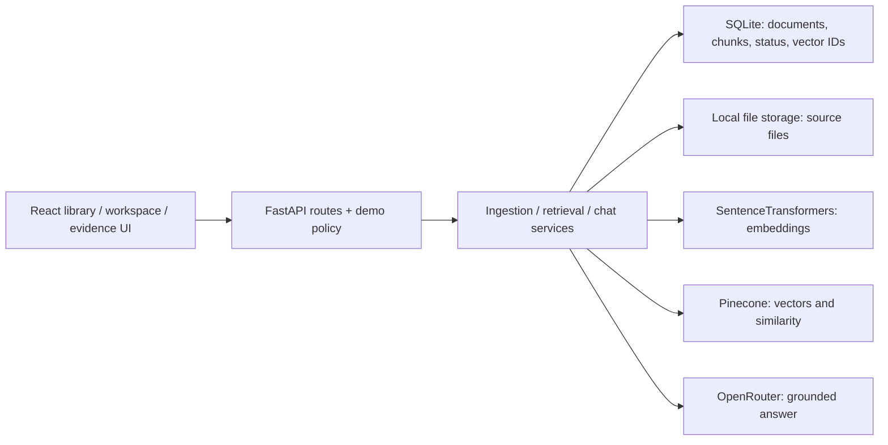
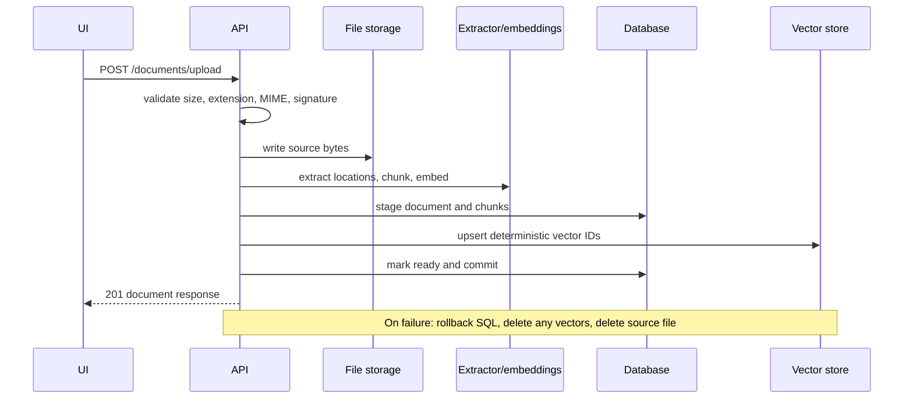
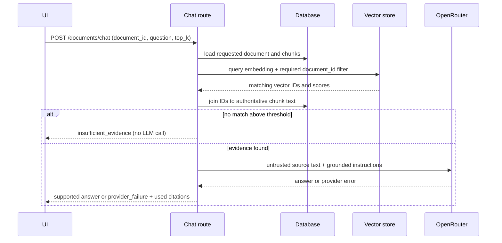

# Architecture

## Current v1.6 architecture

Routes validate/co-ordinate HTTP work. Services own workflows. Repositories isolate SQL access. Small integration interfaces bound embeddings, vector search, file storage, and answer generation; tests inject deterministic fakes.

## Sources of truth

| Data | Owner |
|---|---|
| Document identity, filename, type, size, checksum, processing state | relational database |
| Chunk text, index, source location, vector identifier | relational database |
| Vector values and similarity results | Pinecone |
| Original uploaded bytes | file-storage abstraction (local filesystem in v1.6) |
| Per-document question/answer UI state | browser memory for the current session only |

Embedding arrays are deliberately absent from SQLite. Pinecone metadata contains only isolation/join identifiers, not a second copy of chunk text.

## Ingestion flow

The database commit is last. Since SQL and Pinecone cannot share a transaction, vector upsert failures trigger rollback/file removal; failures after an upsert trigger compensating document-filtered vector deletion.

## Grounded chat flow

The five workflow actions carry explicit intent. Summary, decision, risk, action-item, and date requests select bounded source passages from the chosen document directly; they do not reject the document because a generic prompt has a low semantic score. Direct selections have a null similarity score and are labelled as document passages. Free-form specific questions continue through the thresholded semantic search above. Contextual follow-ups carry the previous question and cited chunk IDs, which are resolved only within the selected document; generated answer text is never reused as source evidence.

### Browser-session uploads on Vercel

TXT/PDF/DOCX files are validated and extracted in a temporary directory, embedded through Pinecone Inference, and returned as bounded document state to the browser. React retains the chunks and embeddings until refresh or removal. Chat sends that state back to an otherwise stateless API, which searches the supplied vectors in memory. Uploaded source material does not enter the shared SQL database, Pinecone vector index, or answer cache. Provider calls still receive the text needed for embeddings and answers. Durable local ingestion retains the SQL/file/vector lifecycle above.

## Product state and evidence interaction

The frontend keeps the document library persistent on desktop, a selected-document conversation in the centre, and the retrieved evidence in a right inspector. On narrower viewports, the evidence inspector becomes a drawer. Selecting another document changes both the retrieval target and the visible in-memory history; histories are never persisted to the server.

Citation interaction uses the `source_preview`, page/paragraph location, and score already returned by grounded chat. There is no parallel source-retrieval endpoint or original-document renderer.

## Demo mode boundary

`DEMO_MODE=true` is enforced in FastAPI rather than only hiding controls:

- persistent upload returns 403 unless temporary session uploads are explicitly enabled
- delete returns 403
- document listing and document-scoped grounded chat remain available
- a per-browser-session process-local soft limit bounds new AI calls; successful sample answers are cached, and retrieval misses are not charged
- `/ready` exposes mode and capability flags to the frontend

Bundled synthetic documents are indexed once through the normal ingestion pipeline. Demo mode does not fake embeddings, retrieval, citations, or answers, and it is not an authentication boundary.

## Deletion and boundaries

Deletion removes vectors with the same document filter, removes the local source, and then commits cascading SQL deletion. An interrupted deletion returns 503 and records a failed status for retry where the database remains available; the API never reports complete success after a critical cleanup failure. Distributed rollback is still imperfect because deleted vector values and source bytes cannot be reconstructed, so production storage/jobs should support durable retry and audit.

Stable API errors are returned without secrets or provider internals. Liveness performs no dependency work. Readiness checks SQL and storage, checks vector usability, and verifies LLM configuration without spending tokens.

## Intentionally deferred

Authentication, organisations, tenant isolation, object storage, PostgreSQL, jobs, OCR, durable chat history, audit trails, full distributed rate limiting, provider abstraction beyond the current narrow interfaces, and production observability are not v1.6 features.
