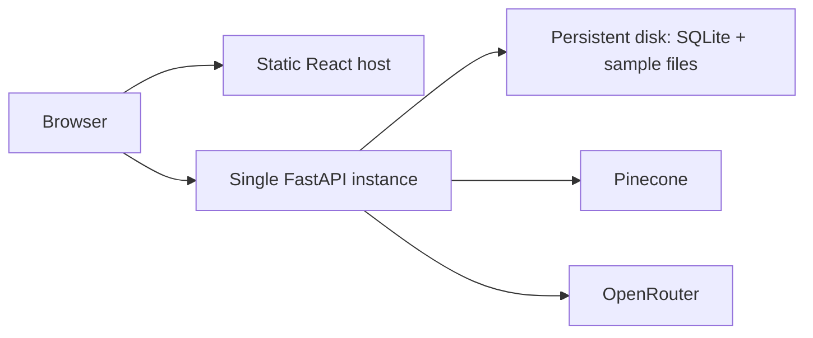

# Portfolio Demo Deployment

## Free Vercel deployment

Live demo: [clientops-copilot-psi.vercel.app](https://clientops-copilot-psi.vercel.app). Verified on 27 October 2026 with sample summaries, source-backed follow-ups, and real AI answers with scoped citations for TXT, PDF, and DOCX uploads. Run `python scripts/smoke_public_demo.py` from `backend/` to repeat these checks against the live site using synthetic files; this consumes free provider quota.

The root `vercel.json` defines a Vite frontend and FastAPI backend on one domain, with `/api/*` routed to Python. `backend/vercel_entry.py` keeps shared samples read-only, enables temporary browser-session uploads, and selects OpenRouter's free model router. The backend installs `requirements-vercel.txt`, avoiding PyTorch and local embedding weights.

Each instance rebuilds the two bundled sample documents and SQL chunk metadata in `/tmp`, using stable document/vector IDs. These files are disposable; the bundled source documents are authoritative. Pinecone Starter stores the corresponding real embeddings and performs document-filtered vector search. `PineconeInferenceEmbeddings` uses passage embeddings during preparation and query embeddings for questions. OpenRouter receives only matching evidence and generates the answer live.

1. Use a Vercel Hobby account and Pinecone Starter project. No plan upgrade is required.
2. Set `PINECONE_API_KEY` and `OPENROUTER_API_KEY` in Vercel's server-side secret store.
3. With local provider credentials configured, run `PYTHONPATH=. python scripts/prepare_vercel_demo.py` from `backend/`. This creates the dedicated `clientops-recruiter-demo` index in the Starter-supported AWS `us-east-1` region, then indexes only the bundled synthetic samples.
4. Run `npx vercel --prod` from the repository root.
5. Verify `/api/health`, `/api/ready`, sample workflows, source-backed follow-ups, TXT/PDF/DOCX upload/chat, and blocked deletion of shared samples.

The `.vercelignore` excludes local secrets, databases, uploads, dependency folders, and tests. Provider keys never belong in `VITE_*` variables. Free tiers impose quotas and have no availability guarantee. A per-browser-session process-local soft limit applies to new AI calls; repeated supported sample answers are cached for an hour, and retrieval misses do not consume this allowance. This is not a distributed or authenticated quota.

Public uploads are capped at 3 MB, 32,000 extracted characters, 60 chunks, and 100 PDF pages. DOCX archives have an expanded-size cap. Parsing uses a temporary directory that is removed after extraction; the response carries source text and embeddings for storage in React state. Subsequent chat requests supply this document state, and cosine search runs in memory against its vectors. Uploads never enter shared SQL, Pinecone vector storage, or the sample answer cache. Text still passes through Pinecone Inference and OpenRouter, so provider retention policies apply. Refreshing the page clears uploaded documents; removing one drops its browser state.

## Recommended topology

The lowest-complexity honest deployment is one persistent backend instance plus one static frontend:

Suitable examples are a static frontend host plus a container host that supports a persistent disk. The backend must remain a single instance because SQLite and local file storage are node-local. A redeploy must mount the same database/upload paths.

The checked-in `fly.toml` and `Dockerfile.fly` implement the smallest working variant as one Fly.io app in Sydney. FastAPI serves the compiled React assets, so the browser uses same-origin API calls. A 1 GB persistent volume owns SQLite and the bundled sample source files; the SentenceTransformer model is baked into the image to keep cold-start behavior predictable.

The root `.dockerignore` excludes Git metadata, local databases, uploads, dependency directories, and every `.env` file from the remote build context. Provider credentials must be supplied only through the platform secret store.

## Backend configuration

- `APP_ENVIRONMENT=production`
- `DEMO_MODE=true`
- `DATABASE_URL=sqlite:////persistent/data/clientops.db`
- `UPLOAD_DIRECTORY=/persistent/uploads`
- `ALLOWED_CORS_ORIGINS=https://your-frontend.example`
- `PINECONE_API_KEY`, `PINECONE_INDEX_NAME`, `OPENROUTER_API_KEY` from the host secret manager
- `DEMO_CHAT_HOURLY_LIMIT` set to the provider budget
- `PROVIDER_TIMEOUT_SECONDS` set between 10 and 30 for an interactive demo

Run `alembic upgrade head`, then `python scripts/seed_demo.py` once. Enable HTTPS, host request limiting, log retention, uptime checks against `/health`, and dependency alerts against `/ready`. Configure Pinecone/OpenRouter spend alerts and restrict the backend network where the host permits it.

## Frontend configuration

Build with `VITE_API_BASE_URL=https://your-api.example`. This value is compiled into the static bundle. Do not place secrets in `VITE_*` variables.

For the combined Fly image, `VITE_API_BASE_URL` is deliberately empty so requests stay on the recruiter-facing origin.

## Persistence and recovery

Back up both the SQLite file and upload directory together. Pinecone vectors can be rebuilt from those authoritative records/source files, but this repository does not yet ship a general rebuild command. Avoid multiple backend replicas; SQLite/local storage would diverge.

## When managed services become necessary

Managed PostgreSQL and object storage are justified when the demo must run multiple replicas, tolerate node replacement without a mounted disk, or support real user data. The repository boundaries already isolate SQL and file storage, but those adapters are intentionally not implemented for the portfolio demo.

## What demo mode does not solve

Demo mode is not authentication, tenant isolation, abuse prevention, or a security certification. It blocks mutations to shared samples while allowing explicitly enabled browser-session uploads. Public endpoints remain subject to host and provider quotas. Free-only generation prevents fallback to paid models; the persistent deployment can support broader workflows with separately configured provider budgets.
